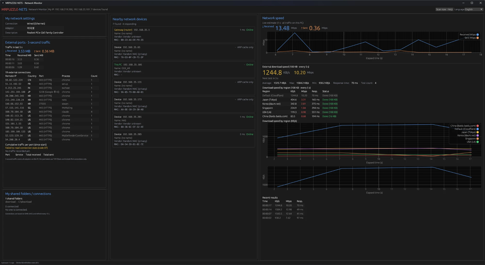
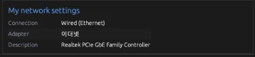
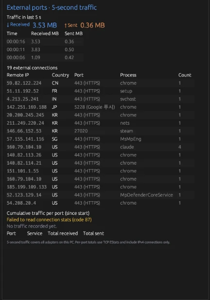
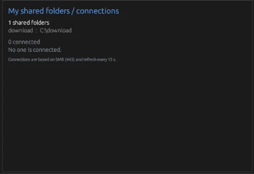
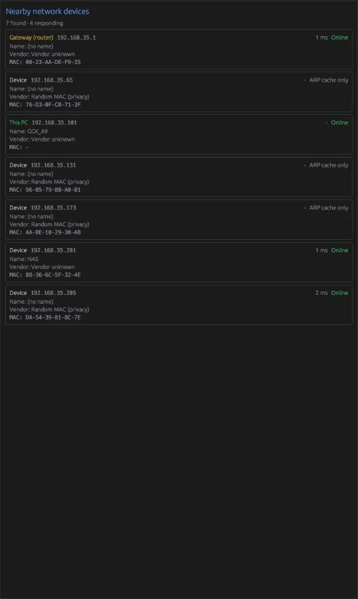
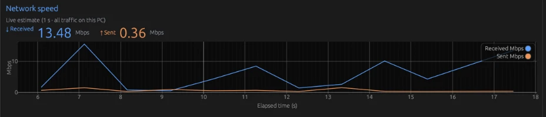
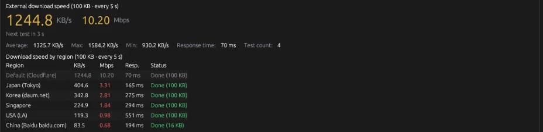
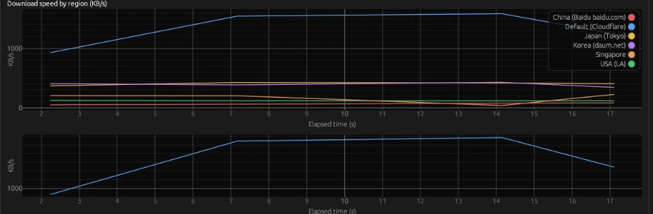
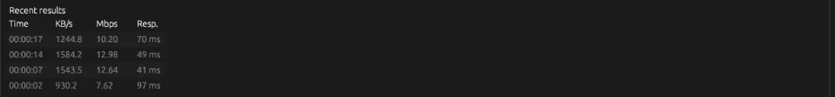

# MRPUZZLE-NETS

A Windows network monitor that shows nearby devices, your network settings, external connections and traffic, and download speed in one window.

- **Author:** MRPUZZLE (C)
- **License:** Free to use and modify. Any use, modification or redistribution must state that it is based on **"MRPUZZLE(C) NETS"** (see [License](#license)).
- **Languages:** 한국어, English, Français, Deutsch, Español, 日本語, 中文, Русский — selected from the picker at the **top right**.

---

## Features

| Area | Description |
|---|---|
| My network settings | Adapter, all IPv4 addresses, subnet mask, gateway, DNS, DHCP status, MAC, link speed, MTU, Wi-Fi SSID / signal / receive rate. Refreshed every 30 s. |
| External connections | Outbound TCP connections grouped by remote IP, port and process, with country codes. Sorted by country. Refreshed every 5 s. |
| 5-second traffic | Received / sent MB over the last 5 seconds, with a 6-interval history. |
| Per-port totals | Cumulative received / sent bytes per remote port. Requires administrator rights. Counted from program start. |
| Shared folders / connections | Folders this PC shares and the IP and host name of SMB (port 445) clients. |
| Nearby devices | Ping sweep of the local /24 subnet with IP, host name, estimated vendor, MAC and response time. Refreshed every 60 s; "Scan now" button available. |
| Live speed estimate | Send / receive estimate for all traffic on this PC, updated every second (Mbps), with a 2-minute graph. |
| External download speed | 100 KB download test every 5 seconds (default: Cloudflare, plus regional servers). |
| Regional speeds | Table and graph for USA (LA), Japan (Tokyo), Singapore, Korea (daum.net) and China (baidu.com). Hover over the graph to see each region's value at that moment. |
| Saved layout | Window size and position, panel sizes and selected language are saved to `nets_settings.ini` and restored on the next start. |

The window starts with a 3 : 2 : 5 split (left, middle, right). Drag the panel borders to resize.

## Screen guide



The window is split into three columns: **left** (settings, external connections, shared folders), **middle** (nearby devices) and **right** (speed).

### 1. Title bar


Shows the program name, this PC's IPv4 addresses, and the device count. **Scan now** starts a device scan, **Help** opens the help window, and the **language picker** (top right) switches the interface language.

### 2. My network settings



Connection type (wired or Wi-Fi), adapter name and description. The full list below also shows IPv4 addresses, subnet mask, gateway, DNS servers, DHCP status, MAC address, link speed and MTU. The panel refreshes every 30 seconds.

### 3. External ports and 5-second traffic



- **Last 5 s:** total received and sent MB for this PC, with the last six intervals.
- **External connections:** outbound TCP connections grouped by remote IP, country code, remote port (with service name, e.g. 443 HTTPS), process and connection count. Rows are sorted by country; LAN and unknown entries are listed last.
- **Cumulative traffic per port:** running totals per remote port since the program started. When the statistics cannot be read, a status message is shown instead. The screenshot shows error 87, which means the per-port totals are not yet working on this build.

### 4. Shared folders and connections



Folders this PC shares (hidden administrative shares such as `C$` are excluded) and the SMB (port 445) clients currently connected, with their IP address and host name.

### 5. Nearby network devices



Devices found in the local /24 subnet, each with:

- **Role:** Gateway (router), This PC (highlighted), or Device
- **Status:** Online (answered ping) or ARP cache only (known from the ARP table but not answering)
- **Name:** host name from reverse DNS, when available
- **Vendor:** estimated from the MAC prefix; "Random MAC (privacy)" marks randomized addresses
- **Response time** and **MAC address**

### 6. Live speed estimate



Receive (↓) and send (↑) rates for all traffic on this PC, updated every second, with a 2-minute graph. This includes local network traffic, not only internet traffic.

### 7. External download speed and regional table



- A 100 KB download test runs every 5 seconds. The big number is the latest result; average, maximum, minimum, response time and test count are shown below it.
- The **region table** lists the default Cloudflare test and each region (Japan, Korea, Singapore, USA, China), sorted from fastest to slowest. Failed or unconfigured regions are listed last.

### 8. Regional speed graphs



The upper graph draws one line per region over time. Hover over it to see every region's value at that moment. The lower graph shows the default Cloudflare test history.

### 9. Recent results



The last eight download tests with time, KB/s, Mbps and response time.

## Requirements

- Windows 10 or 11 (64-bit)
- **Administrator rights** — needed for per-port totals (TCP connection statistics). A UAC prompt appears at startup.
- Internet connection — needed for speed tests and country lookup.
- Built-in Windows tools: `ping`, `arp`, `netstat`, `PowerShell`.

## External services

| Service | Purpose |
|---|---|
| speed.cloudflare.com | Default download test (100 KB) |
| Vultr test files (Los Angeles, Tokyo, Singapore) | Regional download tests (first 100 KB via HTTP Range request) |
| www.daum.net, www.baidu.com | Korea and China regional tests (up to 100 KB of page data) |
| ipinfo.io | Country code of remote IP addresses (one lookup per IP, cached) |

> Remote IP addresses are sent to ipinfo.io for country lookup. To disable this, remove the `country_of` call in `src/conns.rs`.

---

## Build

### 1. Install the tools

1. Install [Rust (rustup)](https://rustup.rs).
2. Install Visual Studio Build Tools with the C++ workload and the Windows SDK.

```bash
winget install --id Rustlang.Rustup -e
winget install --id Microsoft.VisualStudio.2022.BuildTools -e --override "--quiet --wait --add Microsoft.VisualStudio.Workload.VCTools --includeRecommended"
```

### 2. Build

```bash
git clone https://github.com/<your-account>/NETS.git
cd NETS
cargo build --release
```

Output: `target\release\nets.exe`

`build.rs` embeds the icon (`assets/nets.ico`) and version information into the executable and links the administrator manifest. The MSVC toolchain (`x86_64-pc-windows-msvc`) is used.

### 3. Run

Double-click `nets.exe`, or run it from a terminal, and approve the UAC prompt.

---

## Settings file

Layout and language are stored in `nets_settings.ini`, next to the executable:

```ini
win=1500,800
pos=100,50
left=450
right=750
net_h=300
share_h=260
lang=0
```

Language codes: `0` 한국어, `1` English, `2` Français, `3` Deutsch, `4` 日本語, `5` 中文, `6` Русский, `7` Español

## Project structure

```
NETS/
├─ Cargo.toml
├─ build.rs            # icon / version resources, administrator manifest
├─ assets/nets.ico     # application icon (puzzle piece + network)
├─ tools/make_icon.ps1 # icon generator script
├─ doc/README.md
└─ src/
   ├─ main.rs          # UI (egui), help window
   ├─ i18n.rs          # translation tables (8 languages)
   ├─ scanner.rs       # nearby device discovery (ping, arp)
   ├─ netinfo.rs       # network settings (PowerShell)
   ├─ traffic.rs       # 1-second send / receive estimate (netstat -e)
   ├─ speed.rs         # external and regional download tests
   ├─ conns.rs         # external connections, country lookup, TCP EStats totals
   ├─ shares.rs        # shared folders, SMB clients
   ├─ oui.rs           # vendor estimate from MAC prefix
   └─ settings.rs      # layout and language storage
```

## Dependencies

- [eframe / egui 0.29](https://github.com/emilk/egui) — GUI
- [egui_plot 0.29](https://crates.io/crates/egui_plot) — graphs
- [ureq 2](https://crates.io/crates/ureq) — HTTP requests
- [winres](https://crates.io/crates/winres) — executable icon and version resources (build time)

## Known limitations

- Per-connection byte counters use the Windows TCP connection statistics (EStats) API, which requires administrator rights. Only IPv4 connections are counted.
- The live estimate covers all traffic on this PC, including local network traffic, not only internet traffic.
- Device discovery scans only the /24 subnet of the default route.
- The vendor table covers a limited set of prefixes.
- Regional speeds are reference values measured from this PC's location to each server.
- External services may change or become unavailable at any time.

---

## License

This program is **free to use**, and you are **free to modify and improve the code**.

Any use, modification or redistribution **must state that it is based on "MRPUZZLE(C) NETS"**.

- License type: free license with attribution required
- Similar to: Creative Commons CC BY 4.0 and MIT

Third-party components (Rust, eframe/egui, egui_plot, ureq: MIT OR Apache-2.0) remain under their respective licenses.

© MRPUZZLE
